# 🛠️ Alembic Assembly Guide

Welcome to the step-by-step assembly guide for the **Alembic Toolhead**.

*The machine you are building now will be a reflection of the effort committed to assembling it. Attention to detail is directly related to both the performance of the machine and its longevity.*

> [!CAUTION]
> **Important Torque Notice (Aluminum vs. Printed Plastic)**
> The milled portions of this toolhead assembly are **aluminum**—including the X-carriage, the A3DP FXD extruder body, and the hotend mounting plate. Fasteners threading directly into these aluminum components can be tightened to proper engineering torque (~**1.2 Nm** / **10.6 in-lbs**).
> 
> However, **the remaining structural and pneumatic parts are 3D-printed and SHOULD NOT be overtightened.** Stop turning as soon as the plastic begins to compress to avoid crushing O-ring grooves or splitting layer lines.

> [!WARNING]
> **Threadlocker & Plastic Compatibility**
> If using threadlocker on fasteners that thread into metal (such as [Loctite 222MS Purple](https://kb-3d.com/store/tools-equipment/774-loctite-threadlocker-222ms-low-strength-purple-mil-spec-6ml-1673749510419.html?affp=6182) on M3 screws), apply a tiny drop only to the metal threads. **Never allow liquid threadlocker to contact ABS, ASA, or PC printed parts**, as anaerobic threadlockers chemically attack amorphous plastics and cause rapid stress cracking.

---

## Preparation: Tubing Bending Jig

To deliver focused, high-velocity cooling air directly below the nozzle tip without colliding with the print, the two `5mm OD x 3mm ID` aluminum tubes must be formed to exact profiles without kinking or flattening their walls.

A pair of specialized 3D-printable forming tools (`Bend_Tool_Base.stl` and `Bend_Tool_Lever.stl`) are included in [`STL_Files/`](STL_Files) to make this repeatable:

1. **Print the Jig:** Print both the base and lever with **4+ wall perimeters and 40%+ infill** (see [Print Settings](Print_Settings.md)) so they remain rigid under bending loads.
2. **Calculate Insertion Depth:** Measure the vertical distance from the tube passthrough on the `Lower_Body` to the bottom edge of your installed heatblock, then **divide that distance by two**. This value is how far the straight tube should extend into the jig to where the bend begins.
3. **Seat the Tube:** Insert your straight `5mm OD x 3mm ID` aluminum tube (~55mm initial length) firmly into the starting channel on the **Bend Tool Base** using the measurement from Step 2.
4. **Form the Bend:** Slide the **Bend Tool Lever** over the exposed end of the tube and apply smooth, continuous pressure to wrap the tube around the base's radius until it matches the final profile. Repeat for the second tube so you have a matched left/right pair.

> [!TIP]
> **Preventing Tube Kinks & Tool Breakage**
> - **Internal Bend Support:** Because the aluminum tube has a `3mm ID`, aggressive bending can slightly ovalize or kink the inner wall. If you experience deformation, slide a `<3mm` flexible mandrel inside the tube before bending—**2.8mm plastic welding rod** or **2.85mm filament** works exceptionally well and pulls out easily after the bend.
> - **Initial Tool Spacing:** Leave **5mm to 10mm of gap** between the face of the **Bend Tool Base** and the tip of the **Bend Tool Lever** when starting the bend (as shown in *Fig. 1*). Starting with the two printed tools pressed flush together concentrates leverage at a single point, which can kink the tube or snap the lever tip.

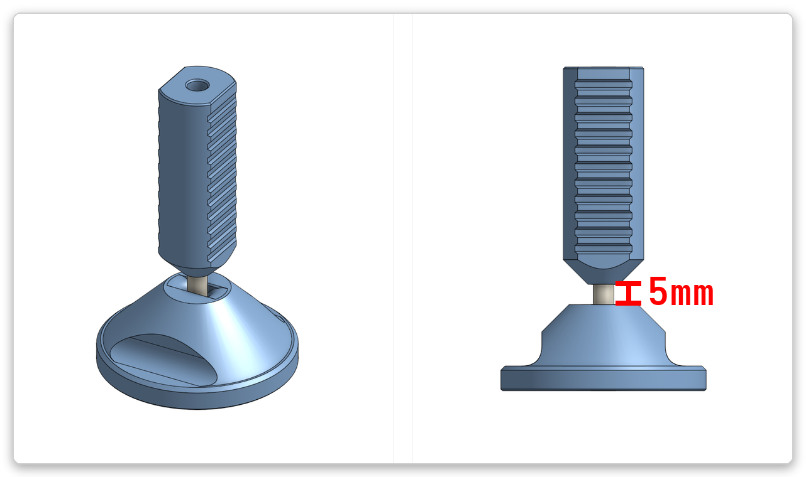 
*Fig. 1: Tubing bend tool layout highlighting the mandatory 5mm–10mm initial spacing before applying leverage.*

---

## Preparation: Heat Set Inserts

Use a temperature-controlled soldering iron (set near your filament's printing temperature) to press the M3x5x4mm brass heat-set inserts squarely into the printed parts until flush with the surrounding plastic.

1. Press **(2) M3x5x4mm heat-set inserts** into the top of the **Intake** component (*Fig. 2*).
2. Seat the first **9x2mm O-ring** into the recessed groove on top of the Intake, then thread the **PC4-M10 Bowden fitting** down over it (*Fig. 2*). Installing the O-ring before threading the fitting prevents air leaks at the umbilical entry.
3. Press **(2) M3x5x4mm heat-set inserts** into the **Strain Relief** block (*Fig. 3*).
4. Join the Strain Relief block to the Intake assembly using **(2) M3x20mm** screws (*Fig. 4*).

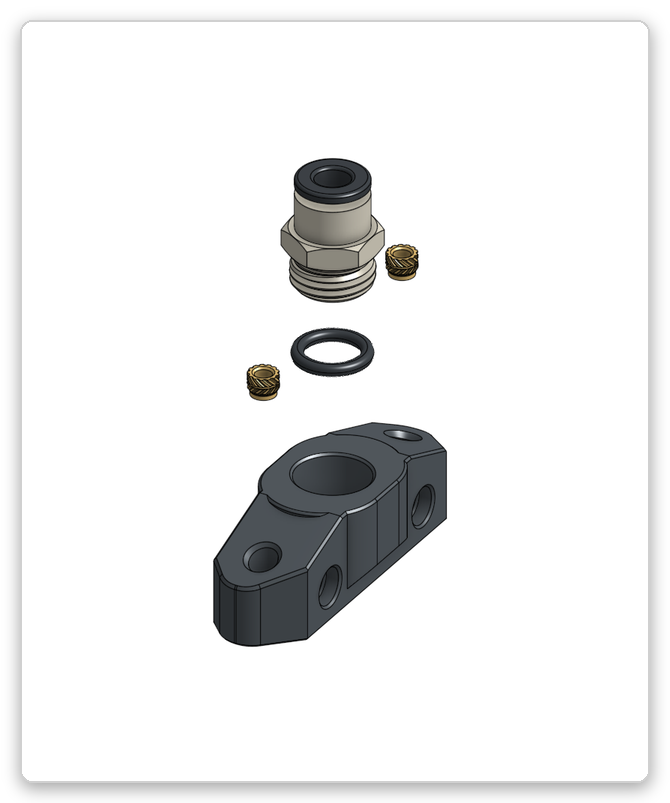 
*Fig. 2: Install (2) M3x5x4mm heat-set inserts into the intake component, seat the 9x2mm O-ring, and thread in the PC4-M10 fitting.*

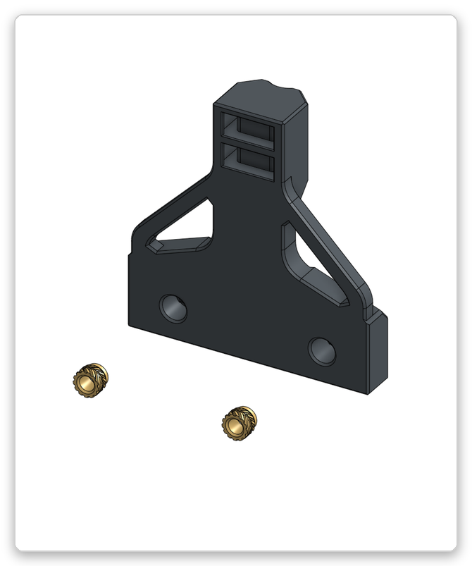 
*Fig. 3: Install (2) M3x5x4mm heat-set inserts flush into the strain relief block.*

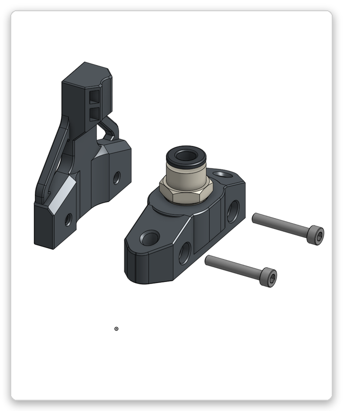 
*Fig. 4: Fasten the strain relief block and intake sub-assembly together.*

---

## Step 1: Main Body and Tubing

1. Slide the two formed `5mm OD` aluminum cooling tubes up through the channels in the **Lower Body** (*Fig. 5*).

> [!TIP]
> **Nozzle Tip Aiming & Clearance (5° Toe-In)**
> By design, the aluminum tubes rotate approximately **5 degrees** inward so their airflow paths converge at a vertex directly **underneath the nozzle tip**. Before locking the tubes down, verify two things against your installed hotend:
> 1. The converging air streams point just below the tip of the nozzle.
> 2. The lowest edge of both metal tubes sits **above the nozzle tip plane** so the tubes can never catch on curling overhangs or printed layers.

2. Seat the second **9x2mm O-ring** into the sealing groove on top of the **Manifold Frame** before mating the Intake during vertical assembly (*Fig. 6*).
3. Thread the **(2) M3x4mm grub screws** into the front of the Lower Body to lock the aluminum tubes at the set height and angle (*Fig. 7*).

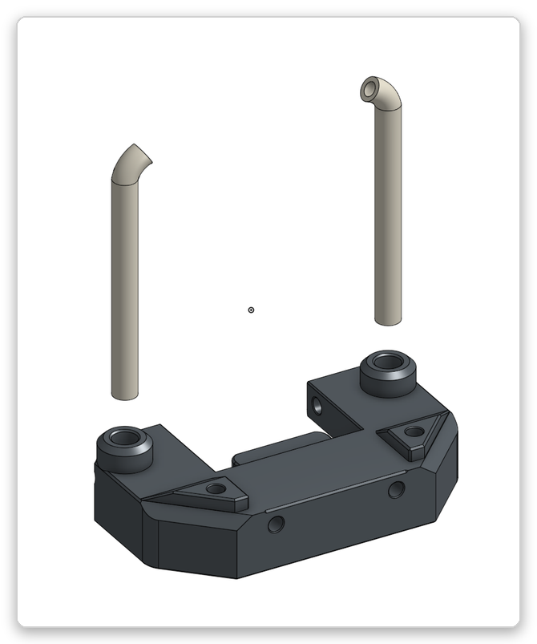 
*Fig. 5: Insert the formed 5mm aluminum cooling tubes into the Lower Body.*

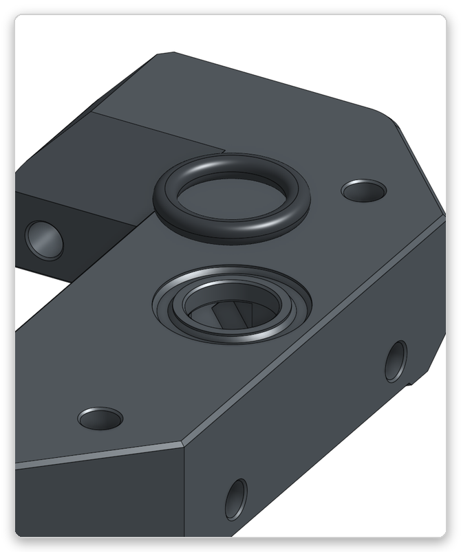 
*Fig. 6: Ensure the second 9x2mm O-ring is fully seated in the upper groove of the Manifold Frame before mating the Intake.*

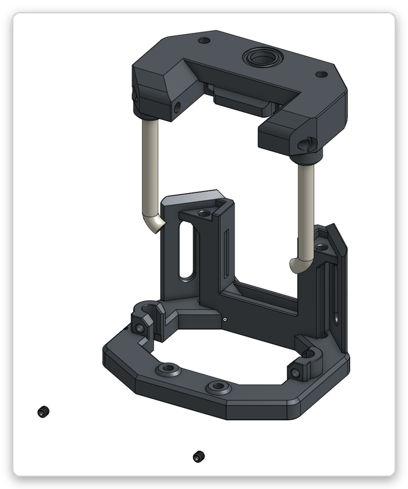 
*Fig. 7: Snug the M3 grub screws against the aluminum tubes to prevent rotation—do not overtighten or crush the tubing walls.*

---

## Step 2: Vertical Assembly and Mounting

1. Bring the **Intake/Strain Relief sub-assembly**, **Manifold Frame**, and **Lower Body** together and tie the vertical stack using the **(2) M3x65mm SHCS** screws (*Fig. 8*).

> [!TIP]
> **Seating the Intake-to-Manifold O-Ring**
> During this step, the second **9x2mm O-ring** must sit cleanly between the Intake and the Manifold Frame. The easiest way to keep it from shifting is to rest the Manifold Frame on the carriage mount first, set the O-ring into the top manifold groove, and then lower the Intake straight down onto it before inserting the 65mm SHCS screws. Proper O-ring alignment is critical—a pinched seal will leak cooling air before it reaches the nozzle tubes.

2. Fasten the assembled Alembic body to the milled aluminum carriage mount using **(4) M3x8mm SHCS** screws—two through the front into the aluminum mounting block and two (one on each side) in the rear (*Fig. 9*).

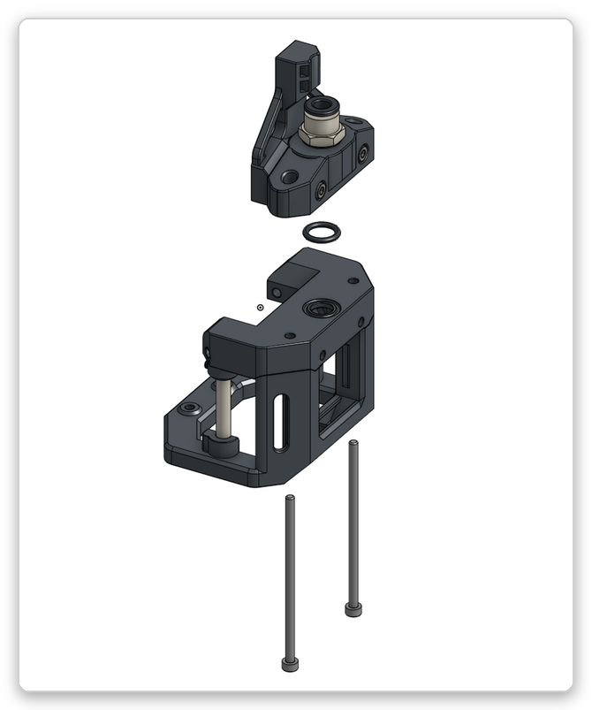 
*Fig. 8: Align the Intake, O-ring, Manifold Frame, and Lower Body, then tie the vertical stack together with (2) M3x65mm SHCS screws.*

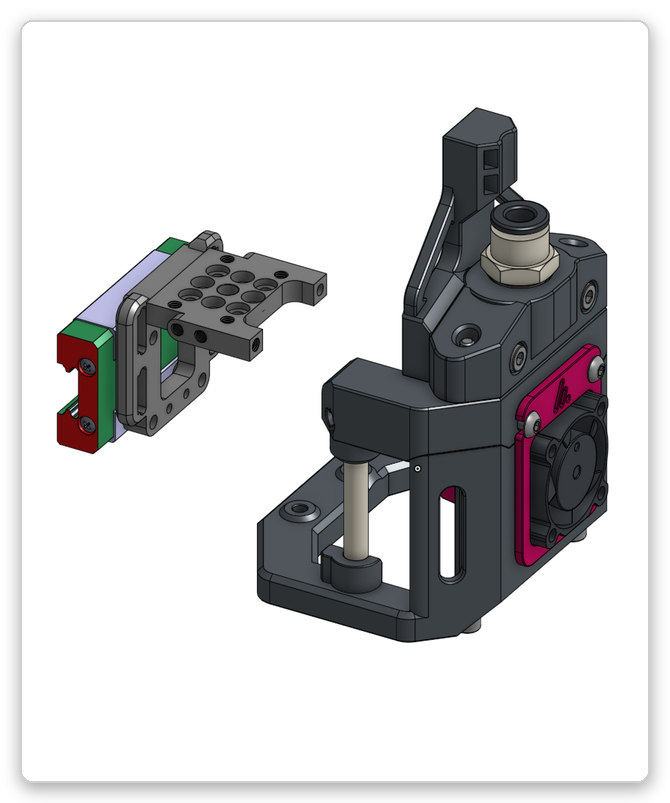 
*Fig. 9: Secure the main Alembic body to the milled aluminum carriage mount.*

---

## Step 3: Hotend Baffle and 2510 Fan

Select the fan baffle printed for your hotend (`Fan_Baffle_Takoto.stl` or `Fan_Baffle_Dragon.stl`):

1. Press the **2510 axial fan** into the baffle's toolless housing until it snaps into place (*Fig. 10*). Check the fan's airflow arrow so it blows **into** the hotend heatsink, and route the fan wire cleanly toward the rear before mounting.
2. Snap the baffle assembly onto the front of the toolhead and secure it through the manifold into the carriage using **(2) M3x24mm BHCS** screws (*Fig. 11*).

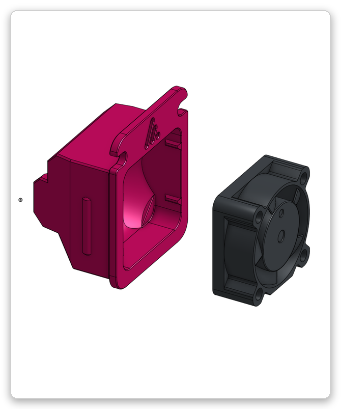 
*Fig. 10: Slide the 2510 fan into the toolless housing, then position the hotend baffle over the heatsink.*

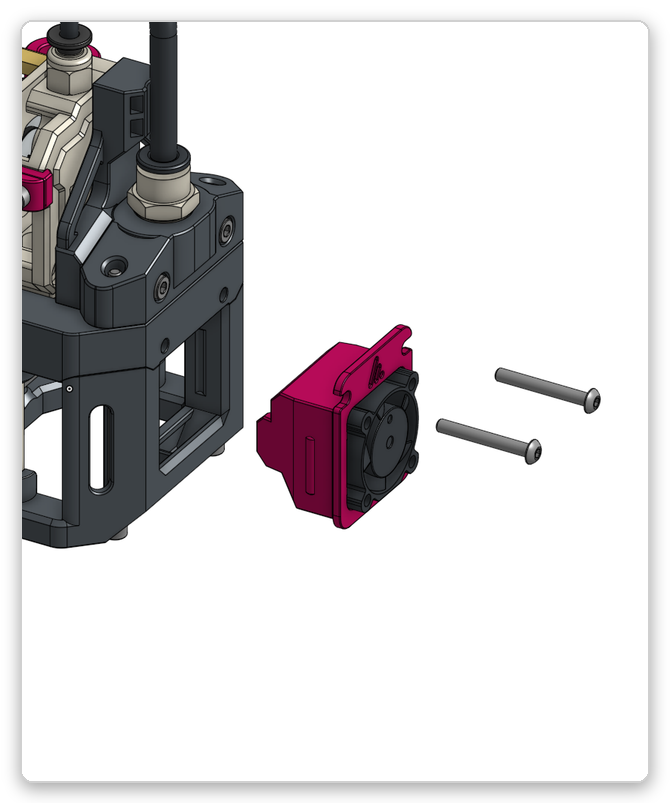 
*Fig. 11: Attach the complete baffle assembly to the carriage using (2) M3x24mm BHCS screws.*

---

## Step 4: Umbilical Strain Relief

Alembic routes three lines to the toolhead: **Igus Chainflex** (for CAN/USB electrical signaling), a **`6mm OD` pneumatic airline** (for part cooling), and a **PTFE Bowden tube** (for filament guidance). Clamping all three together at the top of the toolhead isolates flexing stress away from your electrical connectors and pneumatic fittings during high-speed travel moves.

1. Seat the Chainflex cable into the `Chainflex_Clamp_Base` and place `Chainflex_Clamp_Main` over it.
2. Secure the clamp assembly with **(2) M3x8mm SHCS** screws (*Fig. 12*), then bundle the Chainflex cable, pneumatic airline, and PTFE tube together along the umbilical path.

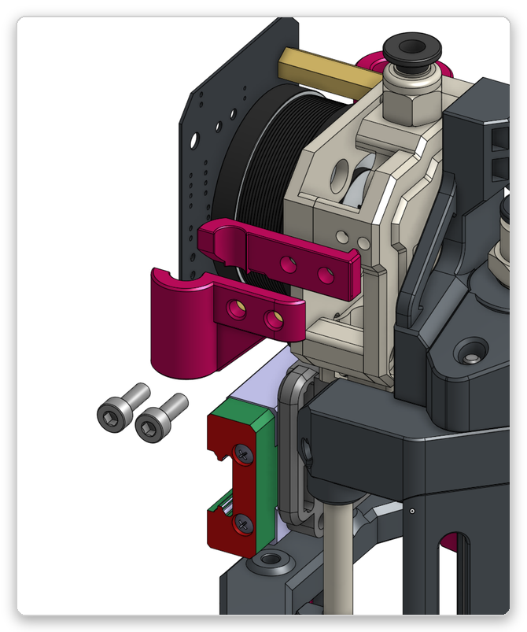 
*Fig. 12: Attach the Chainflex strain-relief clamp to lock the umbilical bundle in place.*

---

## Optional: BDsensor Installation

If you are running a **BDsensor** eddy-current bed probe, install the retainer (`Sensor_Retainer.stl` for Takoto or `Sensor_Retainer_Dragon-MZE.stl` for Dragon/MZE) along with `BD_Mod_Clamp.stl` using **(2) M2x3.5x3mm heat-set inserts**, an **M2x10mm BHCS**, and an **M2x8mm BHCS** (*Fig. 13*).

An offset shim (`Shim_06mm_BDsensor.stl` for Takoto, or `Shim_56_BDsensor_Dragon-MZE.stl` for Dragon/MZE) is included in [`STL_Files/`](STL_Files) to set the proper nozzle-to-sensor Z height.

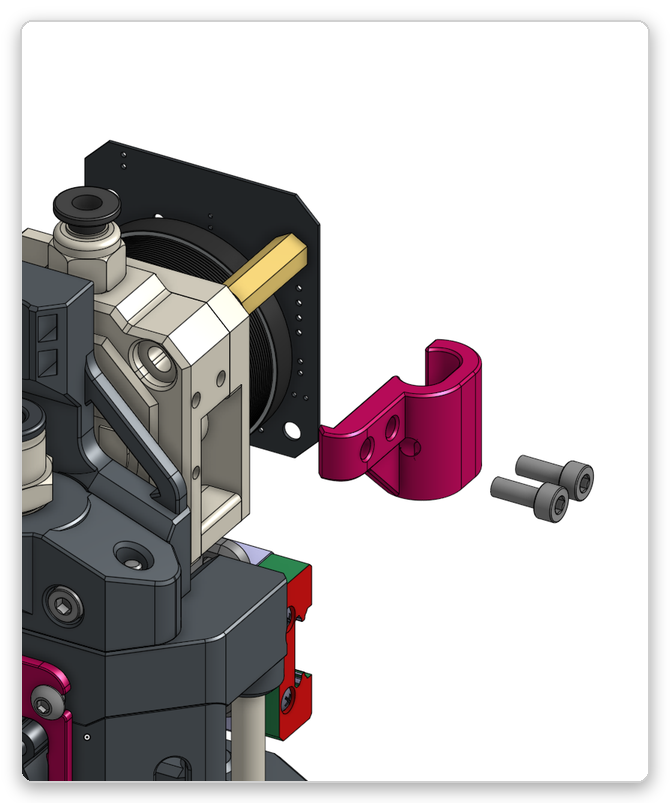 
*Fig. 13: Attach the optional BDsensor retainer, shim, and clamp to the bottom of the carriage.*

---

### End of Assembly
Your **Alembic Toolhead** is now fully assembled and ready to be connected to your [Pneuma Part Cooling](https://github.com/Alchemical-3D/Pneuma_Remote_Air) air supply!

***

> ☕ **Did you find this guide helpful?** 
> 
> My projects are open-source and free for the community. If you've enjoyed my designs and want to support my work, consider [leaving me a tip on Ko-fi](https://ko-fi.com/alchemical3d)! 
>
> 

***
*Documentation prepared with AI editorial assistance • Engineered & maintained by Alchemical-3D.*
