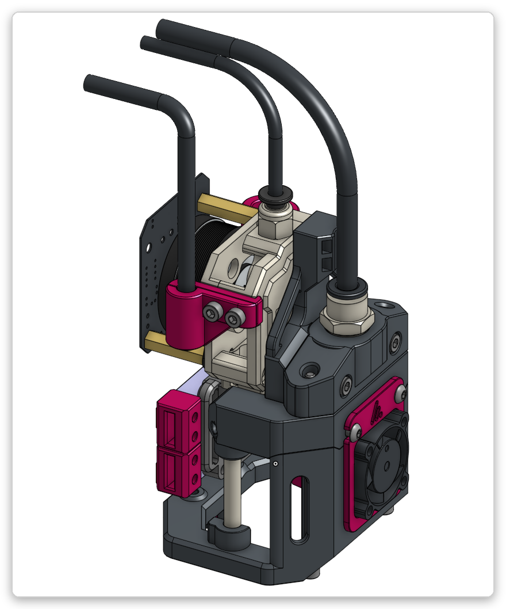
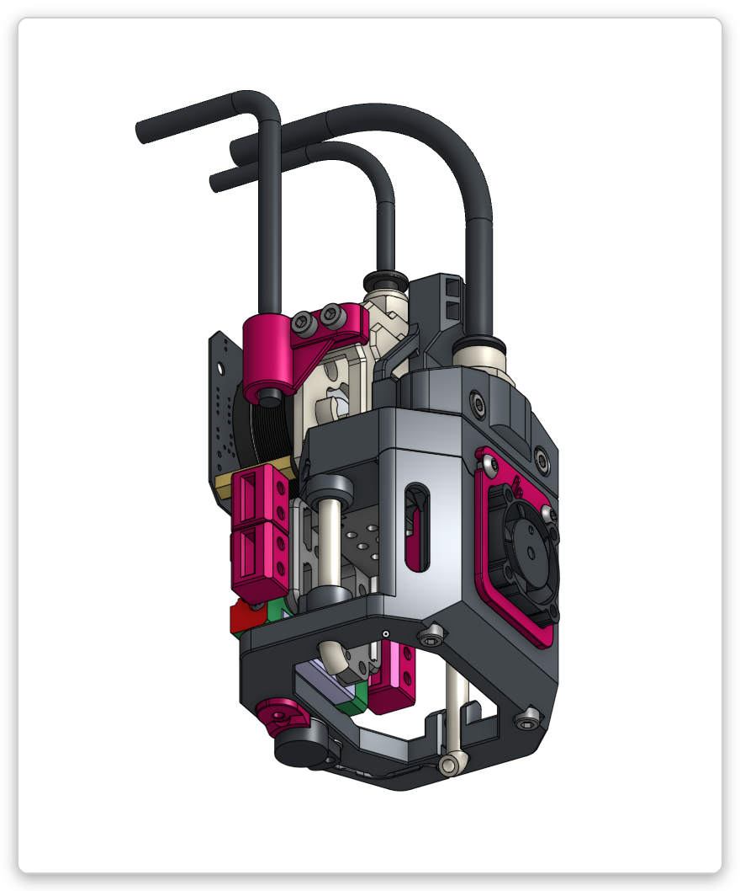
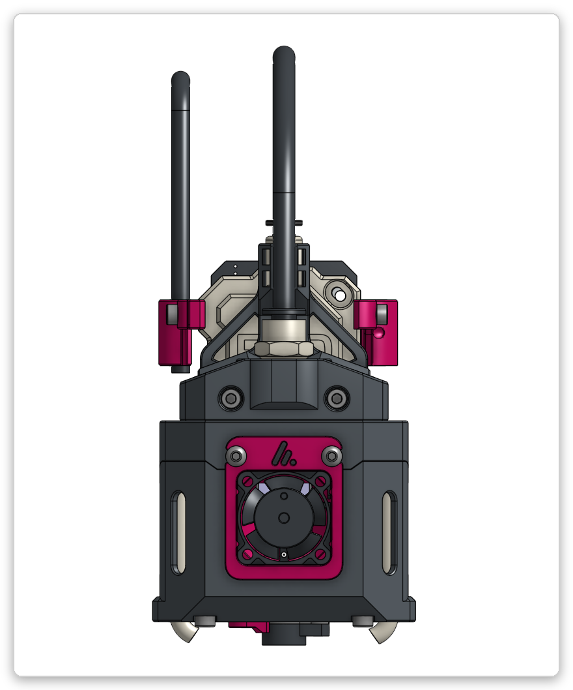

# 🧪 Alembic Toolhead

A highly specialized, ultra-lightweight toolhead engineered for the Alchemical-3D ecosystem and A3DP gantry kits. Alembic replaces bulky part-cooling blowers with a rigid, compressed-air cooling architecture that sheds moving mass while delivering pinpoint airflow at the nozzle tip. This toolhead is currently in the **Alpha phase** of development with proven working builds—please review our **[Alpha State & Development Direction](ALPHA_&_DIRECTION.md)** document for hardware support, the project roadmap, and how to share feedback.

  
  &nbsp;
  

**[Bill of Materials](BOM.md)** &nbsp;•&nbsp; **[Assembly Guide](Assembly_Guide.md)** &nbsp;•&nbsp; **[Print Settings](Print_Settings.md)** &nbsp;•&nbsp; **[Alpha State & Direction](ALPHA_&_DIRECTION.md)**

 

---

## 🌬️ The Philosophy of Alembic

Alembic differentiates itself by dropping traditional 4010 or 5015 part-cooling fans entirely. Instead, it routes remote pressurized air through a pneumatic umbilical directly into twin formed aluminum tubes aimed beneath the nozzle.

Why does this matter for your prints?
- **Penetrating the Thermal Boundary Layer:** High-velocity, directed air streams cut cleanly through the insulating pocket of hot air surrounding freshly extruded plastic, solidifying bridges and steep overhangs immediately without washing the entire heatblock or bed in cold drafts.
- **Structural Mass Reduction:** By using the `5mm OD x 3mm ID` aluminum cooling tubes as rigid structural members and moving the air pump off the X-axis, Alembic keeps the carriage light, stiff, and compact—reducing ringing artifacts, supporting higher CoreXY accelerations, and leaving an unobstructed view of the nozzle.

> [!NOTE]
> **Sledgehammer vs. Scalpel**
> *"While traditional systems focus on brute-forcing CFM to wash the print area with ambient air, Alembic focuses on exact air placement and extreme air speed to achieve superior results. Where CPAP setups are the sledgehammer... Alembic is the scalpel."*

---

## ✨ Key Specifications & Features

- **Primary Extruder Support:** Initial geometry is tailored for the **A3DP FXD** extruder, with modular mounting expansions underway for additional extruders.
- **Supported Hotends:** Includes direct-fit fan baffles and BDsensor retainers for both the **Takoto** and **Dragon** hotends.
- **Part Cooling Architecture:** High-speed compressed air delivered via a `6mm OD x 4mm ID` pneumatic feed tube into twin `5mm OD x 3mm ID` formed aluminum nozzle tubes.
- **Hotend Cooling:** Powered efficiently by a single lightweight, toolless snap-in **2510 axial fan** *(for now...)*.
- **Umbilical Strain Relief:** Dedicated, mechanically clamped routing channels for **Igus Chainflex (CAN/USB wiring)**, the `6mm OD` pneumatic airline, and the PTFE filament guide tube.

> [!TIP]
> **Pneumatics & Companion Air Supply**
> *This toolhead uses quiet, continuous-duty pressurized air (similar to medical or aquarium diaphragm/vacuum pumps rather than loud shop compressors). Pair Alembic with the **[Pneuma Part Cooling](https://github.com/Alchemical-3D/Pneuma_Remote_Air)** system—an Alchemical-3D companion project that provides quiet, Klipper-controlled dual-pump air delivery (switching between cool room air and warm chamber air) designed specifically for Alembic.*

---

## 📚 Documentation Index

Everything you need to print, source, and assemble Alembic on your machine:

| Category | Description |
| :--- | :--- |
| 📋 **[Bill of Materials (BOM)](BOM.md)** | Complete checklist of printed `.stl` parts, heat-set inserts, fasteners, O-rings, and electronics required. |
| 🛠️ **[Assembly Guide](Assembly_Guide.md)** | Fully-illustrated, step-by-step walkthrough covering tube bending, O-ring sealing, and carriage assembly. |
| ⚙️ **[Print Settings](Print_Settings.md)** | Recommended high-temp filaments (ABS/ASA/PC), slicer parameters, and calibration tips. |
| 🧭 **[Alpha State & Direction](ALPHA_&_DIRECTION.md)** | Current hardware compatibility, staged roadmap upgrades, and community feedback channels. |

---

## 🔗 Related Ecosystem Projects

- **[Pneuma Part Cooling](https://github.com/Alchemical-3D/Pneuma_Remote_Air):** Remote dual-pump pneumatic cooling unit with Klipper macro integration (`M106`/`M107`) built to drive Alembic.
- **[A3DP Gantry Assembly](https://github.com/Alchemical-3D/A3DP_Gantry_Assembly):** Modular, milled-aluminum CoreXY gantry system that Alembic mounts to natively.

---

## 📸 Quick Glimpse

  

***

## ⚖️ License

This project is licensed under the **Creative Commons Attribution-NonCommercial-ShareAlike 4.0 International License**. See the [LICENSE.md](LICENSE.md) file for details.

***

**[Join the Alchemical-3D Discord!](https://discord.gg/aE49DW2xXe)**

> ☕ **Did you find this guide helpful?** 
> 
> My projects are open-source and free for the community. If you've enjoyed my designs and want to support my work, consider [leaving me a tip on Ko-fi](https://ko-fi.com/alchemical3d)! 
>
> 

***
*Documentation prepared with AI editorial assistance • Engineered & maintained by Alchemical-3D.*
